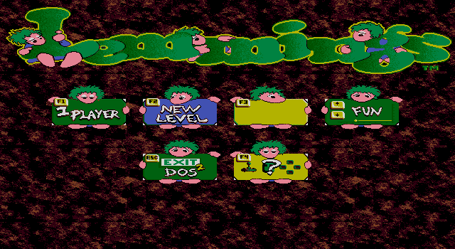
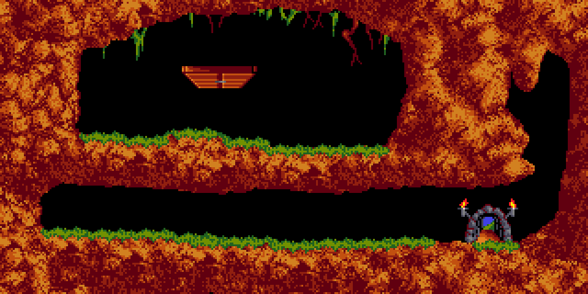

# PC Lemmings, reconstructed

A reimplementation in C of **PC Lemmings (VGA)** — DMA Design / Psygnosis,
1991 — reconstructed by reverse engineering the original executable and its
data files.




```sh
make
./lemmings --data /path/to/lemmings              # the main menu, in a window
./lemmings --data /path/to/lemmings --level 2    # a level, in a window
./lemmings --data /path/to/lemmings --out x.bmp  # write a picture instead
```

Run with no arguments it **shows a screen**. A reconstruction whose default
output is a bitmap is a converter; asking for `--out` or `--raw` is what turns
the window off.

**The game's level order is not its file order.** What the original calls
"Level 1" is section 1 of `level009.dat`, not the first level of the first
file - established by running the original under an emulator and reading its
own briefing screen ("Just dig!", 10 lemmings, 10% to be saved, release rate
50, 5 minutes, diggers only), then confirming this parser gives exactly those
numbers. That pair is the default. What maps a level number onto a file and a
section has not been traced yet.

Arrow keys scroll (hold Shift to go faster), Home and End jump to the ends,
Esc quits.



## Licence

**The original's licence is unknown**, so this repository does not put one on
the reconstructed code. `src/game.c` and `src/game.h` are transcribed from, and
measured against, `vgalemmi.exe` — a binary nobody here owns — and stamping an
SPDX line on them would assert terms and authorship that are not ours to
assert, in a form downstream tools would believe. Those files carry a
provenance header saying what they are and where they came from instead, which
is the more useful thing anyway.

`src/sdl_io.c`, `src/main.c` and the tests are the port's own work and are a
separate matter. Nothing of the game's data is redistributed here: it reads
your own copy.

## What it needs

A C11 compiler and **SDL3**, which is a hard dependency rather than an option:

```sh
sudo dnf install SDL3-devel        # Fedora
sudo apt install libsdl3-dev       # Debian, Ubuntu
brew install sdl3                  # macOS
```

SDL3 and nothing else - no image codecs, no game engine, no other libraries,
and nothing platform-specific. The point of a reconstruction is that it is the
same game somewhere the original cannot run, and a display layer tied to one
platform quietly takes that back. There is deliberately no second rendering
path and no headless fallback either: two paths drift, and only whichever one
your build takes ever gets looked at. SDL's job stops at putting the port's own
composed 8-bit buffer in a window and handing back input - it scales by whole
pixels and filters nothing.

It reads **your own copy of the original data files**: `main.dat` for the menu,
and `level009.dat`, `ground0o.dat` and `vgagr0.dat` for the first level.
Nothing of the game is included here.

`--data` is the directory holding them. The output is a 24-bit BMP, because
that needs no dependencies; convert it with anything.

## What it does so far

Shows the **main menu** and draws a level's terrain:

- **The main menu** — the tiled background, the logo and all six signs, from
  `MAIN.DAT`, in the original's own EGA 640x350 16-colour screen
- **DAT decompression** — the container format all of Lemmings' data uses,
  transcribed from image `0x01BAF` and checked call-for-call against the
  original
- **Level parsing** — globals, terrain, objects, steel areas, the name
- **GROUNDxO.DAT** — the per-set index of bitmaps and the 16-colour palette
- **VGAGRx.DAT** — 4-bit planar bitmaps
- **Terrain composition** — drawing order with the no-overwrite, erase and
  upside-down flags
- **Interactive objects** — the entrance and the exit, with their own
  transparency masks and animation frames

The menu answers to its keys and to the mouse, and four of its six plates do
what the original does:

| plate | |
| --- | --- |
| **F1** "1 PLAYER" | starts the level; leaving it returns to the menu |
| **F2** "NEW LEVEL" | the "Enter Code" screen |
| **F3** "FX" | nothing — which is what the original does here too |
| **F4** "?" | the "Choose Input Type" screen |
| **Esc** | quits |
| the rating plate | nothing works it, in the port or the original |

F1 goes through the **level briefing** first, as the original does — its text
is read back off the original's own screen and matches 97.99% of text pixels,
though its background has not been found and is left black.

Clicking anywhere acts as F1, including on "EXIT TO DOS" — that is what the
original does. It hides the mouse cursor on this screen and reads only the
button, so the plates are keyboard-only.

None of that was guessed from the labels: a probe drives the original to its
menu, presses one key, and diffs the screen against a no-key baseline.

There is no game yet: no lemmings, no skills, no animation, no sound. Nothing
on the menu animates either - the lemmings' eyes do not blink and the scrolling
banner at the foot is not drawn.

## How it is laid out

`src/game.c` and `src/game.h` are the reconstruction, in **one translation
unit**. That is deliberate and it is not a modern instinct: compilers of the
period emitted one object per source file and the linker laid each module into
the segment whole and in link order, so a contiguous run of addresses *is* one
original source file, and address order is source order inside it. That is the
only division of this program its authors actually made. This port used to be
eight files split by concern - `dat.c`, `level.c`, `render.c` and so on - a
division nothing in the binary supports, and one that left "which file is image
`0x03F5C` in?" with no answer.

Every function says where it came from: the image offset if it is transcribed,
or an explicit note that it is not and that where it lives in the original is
not yet established.

`src/sdl_io.c` and `src/main.c` are boundaries the **port** chose - what a
modern backend has to replace, and a command line the original never had. Their
headers say so.

## How it is known to be right

**Its data loading is proven byte for byte.** The development repository has a
check that takes the bytes the *original* has in RAM after loading a file and
compares them against what this code produces from the same file on disk:
**179 618 bytes across seven sections, byte-identical, none differing** — the
level, both `VGAGR0.DAT` sections including the terrain bitmaps, three sections
of `MAIN.DAT`, and the ground file. Two programs, one input, an exact answer.

**Its terrain rendering is proven byte for byte.** The comparison is not
against the original's *screen* — that carries sprites, a cursor, a palette
fade and a viewport, none of which is the thing being checked. It is against
the level the original **composes in memory**, captured at the exact
instruction its terrain loop finishes:

> **100.00%. 49 741 terrain pixels, zero differing**, across the whole
> 1584x160 level.

That one number covers the DAT decompressor, the level parse, the ground
table, the planar bitmap decode, piece placement, the flags, drawing order and
overlap resolution.


Not yet as thoroughly as it should be, and this section will say so honestly
until that changes.

The **file formats** here were written from published descriptions and then
checked against the real files rather than trusted — the published notes are
wrong or ambiguous in three places, all recorded in the source comments:

- the DAT header's words are **big**-endian, not little
- DAT bits come out of a byte LSB-first while multi-bit values assemble
  MSB-first; no other combination decodes even one level
- the terrain entry's bit packing was settled by decoding all 168 pieces of
  level 1 both plausible ways and keeping the reading where every piece lands
  in range and names a bitmap the set defines (168/168 against 82/168)

**One real check has happened.** The original was run under an emulator as far
as its level briefing screen, which states the level's name and parameters in
the game's own words. This parser, given the same section, reports the same
six values - name, lemming count, percentage to save, release rate, time limit
and the single skill. That is independent confirmation of the level globals,
not a reading of the same document twice.

What has **not** happened is the check that matters most: comparing this
renderer's output against the original's video memory, pixel for pixel, and
its routines against the original's, one at a time. Until then this is a
plausible reimplementation, not a proven one. The development repository holds
the emulator, the verification harness and the disassembly notes.

## Where it deviates from the original, deliberately

- **VGA only.** The original shipped separate CGA, Tandy and EGA/VGA
  executables; only the VGA one is reconstructed.
- **Machine type "High Performance PCs".** The original's start-up menu offers
  four; that is the one that enables no compatibility work-arounds, and the
  other three are not implemented.
- **No copy protection.** The original decrypts itself under the trap flag and
  checks for an original floppy. None of that is reproduced.
- **The window is a viewer, not the game's display loop.** The original draws
  a 320x160 viewport with a control panel below it and paces on the vertical
  retrace; this just shows the composed level and scrolls it.

## Licence

The **reconstruction** — everything in this directory — is GPL-2.0-only.

**Lemmings itself is not included and is not covered by that.** It remains the
property of its rights holders; this code reads data files you must already
have. No game asset, level or executable is redistributed here.
